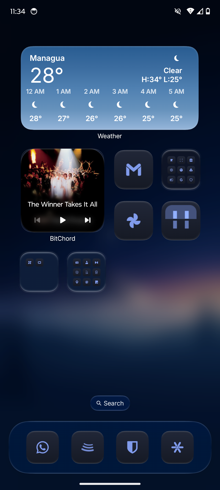
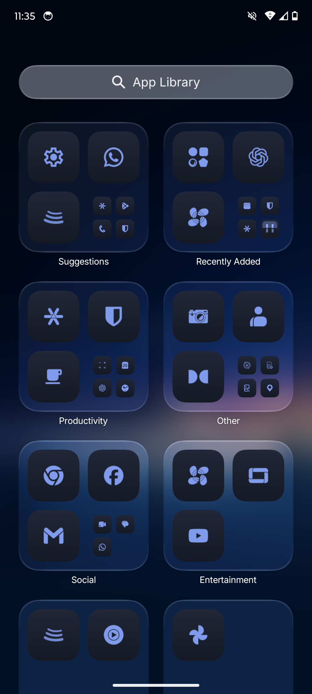
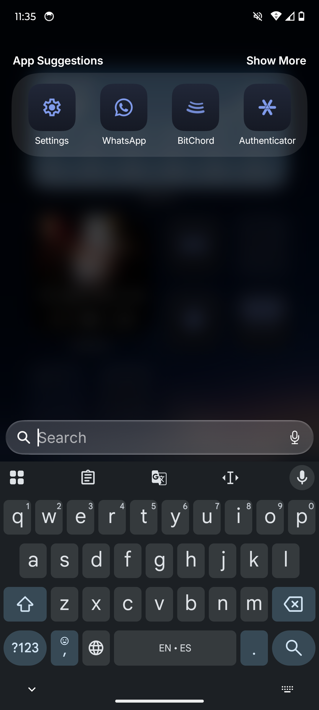

<div align="center">


# Prism

**A fluid, 120 fps Liquid Glass launcher for Android.**

[-3DDC84?logo=android&logoColor=white)](https://developer.android.com)
[](https://kotlinlang.org)
[](https://www.rust-lang.org)
[](LICENSE)

</div>

---

## Screenshots

<div align="center">

| Home Screen | App Library | Search |
| :---: | :---: | :---: |
|  |  |  |

</div>

---

## Highlights

- **120 fps Spring Physics** — Vsync-driven, velocity-preserving springs across paging, folders, search pill morphing, edit-mode reflow, and unlock reveals. Explicitly locks to the display's highest native refresh rate (e.g., 120 Hz).
- **Liquid Glass & Fast Glass (120 fps)** — Real-time AGSL glass refraction with Clear ↔ Tinted clarity control, plus a dedicated **Fast Glass (120 fps)** mode under *Settings › Appearance › Liquid Glass* for ultra-low GPU frame times.
- **Native Rust Blur** — Fast multi-pass pixel blur compiled to `arm64-v8a` via Rust JNI (`libliquidy_native.so`).
- **True App Lock for Hidden Apps** — Hide apps in the biometric-protected Hidden folder *and* automatically lock them if opened from outside the launcher (Recents, notifications, Settings, Play Store) with a theme-aware lock screen, animated padlock unlock, zero-flash Go Home, and instant re-lock on screen off.
- **App Library & Instant Search** — Categorized glass tiles, pull-down A–Z search with a blurred top header, and one-tap **Add to Home Screen** from the context menu.
- **Folders & Edit Mode** — Smooth squircle folder open/close morphs with live anchor tracking, folder paging, renaming, **Remove Folder** confirmation, jiggle/drag/reflow, and dark-mode-aware frosted dialogs.
- **Icon Styles & Customisation** — **Default**, **Dark**, **Clear** (shaded glass-engraved glyphs), and **Tinted** (Light & Dark with matching tinted closed folders), plus icon pack support and a built-in wallpaper editor.
- **Widgets & Today View** — Built-in glass widgets (Clock, Calendar, Batteries, Weather, Photos, Reminders), widget stacks, and Android `AppWidgetHost` support.
- **Compact Release Build** — R8-minified and resource-shrunk release APK (~4.2 MB).

---

## Architecture

| Layer | Technology |
|---|---|
| UI & Gestures | Kotlin, Jetpack Compose, central gesture arena (`HomeScreen.kt`) |
| Motion & Tokens | Centralized spring physics (`Motion.kt`) & design tokens (`DesignTokens.kt`) |
| Glass & Shaders | AGSL `RuntimeShader` (`WallpaperGlass.kt`) & Kyant Backdrop |
| Native Fast Path | Rust JNI (`rust/liquidy_native`) |
| App Lock | `UsageStatsManager` + `TYPE_APPLICATION_OVERLAY` + `BiometricPrompt` |

---

## Building

### Requirements
- Android Studio / JDK 17
- Android SDK (minSdk 33, targetSdk 36)
- *(Optional)* Rust + Android NDK 27 (`aarch64-linux-android`) to rebuild `libliquidy_native.so`

### Release APK
```bash
./gradlew :app:assembleRelease
adb install -r app/build/outputs/apk/release/app-release.apk
adb shell cmd package compile -m speed -f com.gamadev.prism
```

---

## Credits

Created and maintained by **gamadev09**.

## License

This project is licensed under the **GNU General Public License v3.0** — see [LICENSE](LICENSE) for details.

<sub>Forked from Liquidy (GPL-3.0).</sub>
