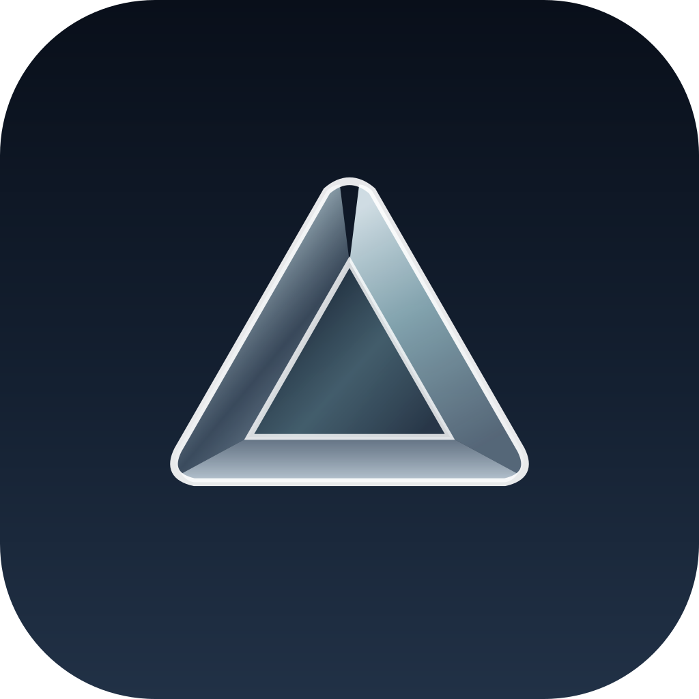
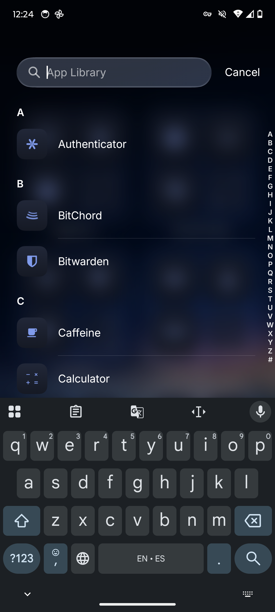

<div align="center">



# Prism

**A fluid, 120 fps Liquid Glass launcher for Android 13+.**  
*Precision spring physics · Real-time AGSL glass · 8 custom icon shapes · True biometric App Lock*

[-3DDC84?logo=android&logoColor=white)](https://developer.android.com)
[](https://kotlinlang.org)
[](https://www.rust-lang.org)
[](LICENSE)

[English](#english) · [Español](#español)

</div>

---

<a id="english"></a>

## Showcase

<div align="center">

| Home Screen (Squircle) | App Library | Blurred A–Z Search | Universal Search |
| :---: | :---: | :---: | :---: |
|  |  |  |  |

</div>

---

## Customise Every Detail

### Icon Styles & Sizes
| Mode | Description |
|---|---|
| **Default** | Original app icons with crisp squircle or custom shape masking |
| **Dark** | Rich dark-gradient icon plates for OLED & night themes |
| **Clear (Light & Dark)** | Shaded glass-engraved glyphs over live Liquid Glass |
| **Tinted (Light & Dark)** | Duotone tinted icons & matching tinted closed folders (Device, Wallpaper, or Custom hue) |
| **Small / Large Icons** | Toggle compact labelled icons or clean, label-free Large icons |

### 8 Built-In Icon Shapes *(with Live 4×2 Preview in Settings)*
**Squircle** · **Pixel** *(8-bit stepped corners)* · **Circle** · **Rounded** · **Square** · **Teardrop** · **Octagon** · **Hexagon**  
All 8 shapes preserve full **Liquid Glass**, **Clear**, **Tinted**, and **Dark** styling across your Home Screen, Dock, Folders, and App Library.

---

## Highlights

- **Adaptive & 120 fps Spring Physics** — Vsync-driven, velocity-preserving springs across paging, folders, search pill morphing, app open/return depth, edit-mode reflow, and unlock reveals. Supports **Auto** Adaptive Refresh Rate (60/90/120 Hz) or locked **120 Hz**.
- **Liquid Glass & Fast Glass (120 fps)** — Real-time AGSL glass refraction with Clear ↔ Tinted clarity control, plus a dedicated **Fast Glass (120 fps)** mode under *Settings › Appearance › Liquid Glass* for ultra-low GPU frame times.
- **Native Rust Blur** — Fast multi-pass pixel blur compiled to `arm64-v8a` via Rust JNI (`libliquidy_native.so`).
- **True App Lock for Hidden Apps** — Hide apps in the biometric-protected Hidden folder *and* automatically lock them if opened outside Prism (Recents, notifications, Settings, Play Store) with a theme-aware lock screen, animated padlock unlock, zero-flash Go Home, Recents-bypass protection, and instant re-lock on screen off.
- **App Library & Folders** — Categorized glass tiles, pull-down A–Z search with a blurred top header, one-tap **Add to Home Screen**, squircle-preserving folder open/close morphs, and **Remove Folder** confirmation dialogs.
- **Widgets & Today View** — Built-in glass widgets (Clock, Calendar, Batteries, Weather, Photos, Reminders), widget stacks, smooth multi-cell grid reflow, and Android `AppWidgetHost` support.
- **English & Spanish Localization** — Full Spanish (`es`) and English (`en`) support with automatic system language detection and an in-app language switcher under *Settings › General › Language* (powered by Android 13+ `LocaleManager`).
- **Compact Release Build** — R8-minified and resource-shrunk release APK (~4.2 MB).

---

## Architecture

| Layer | Technology |
|---|---|
| UI & Gestures | Kotlin, Jetpack Compose, central gesture arena (`HomeScreen.kt`) |
| Motion & Tokens | Centralized spring physics (`Motion.kt`) & design tokens (`DesignTokens.kt`) |
| Glass & Shaders | AGSL `RuntimeShader` (`WallpaperGlass.kt`) & Kyant Backdrop |
| Native Fast Path | Rust JNI (`rust/liquidy_native`) |
| App Lock | `UsageStatsManager` + `TYPE_APPLICATION_OVERLAY` + `BiometricPrompt` |

---

## Building & Installing

### Requirements
- Android Studio / JDK 17
- Android SDK (minSdk 33, targetSdk 36)
- *(Optional)* Rust + Android NDK 27 (`aarch64-linux-android`) to rebuild `libliquidy_native.so`

### Release APK
```bash
./gradlew :app:assembleRelease
adb install -r app/build/outputs/apk/release/app-release.apk
adb shell cmd package compile -m speed -f com.gamadev.prism
```

---

## Credits

Created and maintained by **gamadev09**.  
Originally based on [Liquidy](https://github.com/janhurn9400/liquidy) (GPL-3.0).

## License

This project is licensed under the **GNU General Public License v3.0** — see [LICENSE](LICENSE) for details.

---

<a id="español"></a>

# Prism (Español)

**Un lanzador fluido Liquid Glass a 120 fps para Android 13+.**  
*Física de resortes precisa · Cristal AGSL en tiempo real · 8 formas de iconos · Bloqueo biométrico real de apps*

---

## Personaliza cada detalle

### Estilos y tamaños de iconos
| Modo | Descripción |
|---|---|
| **Predeterminado** | Iconos originales con máscara squircle nítida o forma personalizada |
| **Oscuro** | Placas oscuras con degradado para pantallas OLED y temas nocturnos |
| **Transparente (Claro y Oscuro)** | Glifos grabados en cristal sobre Liquid Glass en tiempo real |
| **Teñido (Claro y Oscuro)** | Iconos duotono teñidos y carpetas cerradas a juego (Dispositivo, Fondo o tono personalizado) |
| **Iconos pequeños / grandes** | Alterna entre iconos compactos con etiqueta o iconos grandes sin texto |

### 8 formas de iconos integradas *(con vista previa 4×2 en Ajustes)*
**Squircle** · **Pixel** *(esquinas escalonadas de 8 bits)* · **Circle** · **Rounded** · **Square** · **Teardrop** · **Octagon** · **Hexagon**  
Las 8 formas mantienen el estilo completo de **Liquid Glass**, **Transparente**, **Teñido** y **Oscuro** en la pantalla de inicio, el Dock, las carpetas y la Biblioteca de apps.

---

## Aspectos destacados

- **Física de resortes adaptable y a 120 fps** — Resortes sincronizados con vsync que conservan la velocidad al cambiar de página, abrir carpetas, transformar la barra de búsqueda, abrir/cerrar apps, reorganizar en modo edición y desbloquear. Compatible con tasa adaptable **Automática** (60/90/120 Hz) o **120 Hz** fijos.
- **Liquid Glass y Cristal rápido (120 fps)** — Refracción de cristal AGSL en tiempo real con control Transparente ↔ Teñido, además de un modo **Cristal rápido (120 fps)** en *Ajustes › Apariencia › Liquid Glass* para tiempos de fotograma mínimos en GPU.
- **Desenfoque nativo en Rust** — Desenfoque rápido multipaso compilado a `arm64-v8a` mediante Rust JNI (`libliquidy_native.so`).
- **Bloqueo real para apps ocultas** — Oculta apps en la carpeta Ocultas protegida por biometría *y* bloquéalas automáticamente si se abren fuera de Prism (Recientes, notificaciones, Ajustes, Play Store) con pantalla de bloqueo adaptable al tema, animación de candado, regreso al inicio sin parpadeos y rebloqueo instantáneo al apagar la pantalla.
- **Biblioteca de apps y carpetas** — Tarjetas de cristal por categorías, búsqueda A–Z deslizando hacia abajo con cabecera desenfocada, **Añadir a la pantalla de inicio** con un toque, animaciones de carpeta y confirmación para **Eliminar carpeta**.
- **Widgets y vista Hoy** — Widgets de cristal integrados (Reloj, Calendario, Baterías, Tiempo, Fotos, Recordatorios), grupos de widgets, reordenación fluida y soporte para `AppWidgetHost` de Android.
- **Idioma en Español e Inglés** — Soporte completo en español (`es`) e inglés (`en`) con detección automática del idioma del sistema y selector integrado en *Ajustes › General › Idioma* (usando `LocaleManager` de Android 13+).
- **Compilación Release compacta** — APK minificado con R8 y recursos reducidos (~4.2 MB).

---

## Arquitectura

| Capa | Tecnología |
|---|---|
| Interfaz y gestos | Kotlin, Jetpack Compose, gestión centralizada de gestos (`HomeScreen.kt`) |
| Movimiento y tokens | Física de resortes centralizada (`Motion.kt`) y tokens de diseño (`DesignTokens.kt`) |
| Cristal y shaders | AGSL `RuntimeShader` (`WallpaperGlass.kt`) y Kyant Backdrop |
| Ruta nativa rápida | Rust JNI (`rust/liquidy_native`) |
| Bloqueo de apps | `UsageStatsManager` + `TYPE_APPLICATION_OVERLAY` + `BiometricPrompt` |

---

## Compilación e instalación

### Requisitos
- Android Studio / JDK 17
- Android SDK (minSdk 33, targetSdk 36)
- *(Opcional)* Rust + Android NDK 27 (`aarch64-linux-android`) para recompilar `libliquidy_native.so`

### APK Release
```bash
./gradlew :app:assembleRelease
adb install -r app/build/outputs/apk/release/app-release.apk
adb shell cmd package compile -m speed -f com.gamadev.prism
```

---

## Créditos

Creado y mantenido por **gamadev09**.  
Basado originalmente en [Liquidy](https://github.com/janhurn9400/liquidy) (GPL-3.0).

## Licencia

Este proyecto está bajo la licencia **GNU General Public License v3.0** — consulta [LICENSE](LICENSE) para más detalles.
